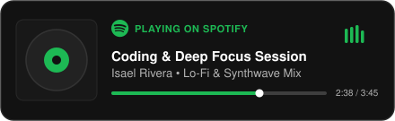

<div align="center">

  <!-- Header Banner & Typing Animation -->
  <h1>¡Hola! Soy Isael Rivera</h1>

  

  <p>
    <em>"The only thing that is impossible is what you don’t try."</em>
  </p>

  <!-- Social Badges -->
  <p>
    <a href="mailto:isaelrivram@gmail.com">
      
    </a>
    <a href="https://www.linkedin.com/in/isael-rivera-ramirez-61a793254/" target="_blank">
      
    </a>
    <a href="https://www.hackerrank.com/profile/isaelrivram" target="_blank">
      
    </a>
    <a href="https://www.instagram.com/is.a_09/" target="_blank">
      
    </a>
  </p>

</div>

---

### Sobre mí / About Me

```yaml
nombre: Isael Rivera Ramirez
universidad: Instituto Tecnológico de la Laguna
enfoque: Desarrollo Móvil, Web Full Stack & Infraestructura Cloud
filosofía: "Code. Eat. Music. Repeat."
actualmente_aprendiendo: Arquitecturas escalables, Cloud Native & Microservicios
```

---

### Tech Stack & Herramientas

<div align="left">

#### Desarrollo Móvil
<p>
  
  
  
  
  
  
</p>

#### Frontend & Web
<p>
  
  
  
  
  
  
</p>

#### Backend, Lenguajes & Bases de Datos
<p>
  
  
  
  
  
  
  
  
  
</p>

#### DevOps, Contenedores & Cloud
<p>
  
  
  
  
  
  
  
  
  
  
</p>

#### Linux, Redes & Seguridad
<p>
  
  
  
  
  
  
  
  
  
  
</p>

</div>

---

### Now Playing & Coding Soundtrack

<div align="center">
  <a href="https://open.spotify.com" target="_blank">
    
  </a>
</div>

<br>

<!-- JUEGO DE LA VIBORITA (SNAKE) -->
<div align="center">
  
</div>
